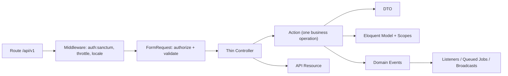
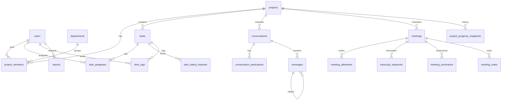
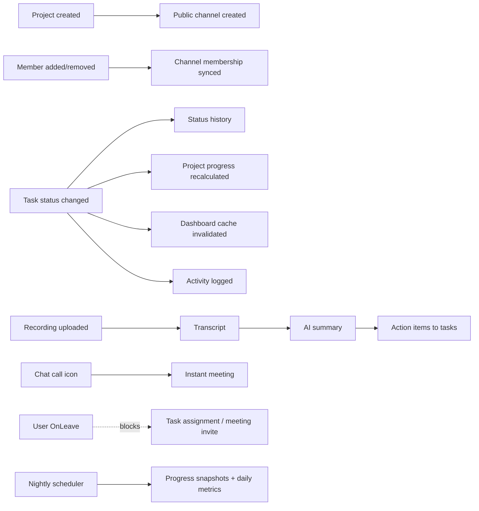

# Collabspace API — Master Roadmap

> Single source of truth for **what** we build, **how** we build it, and **in which order**.
> Every phase below ends with: code + tests + a feature document in [`docs/features`](features) + a push to GitHub.

**Evaluation pillars:** Clean Code · Security · Performance · Business.
Every technical decision in this document is tagged with the pillar it serves: 🧹 Clean Code · 🔒 Security · ⚡ Performance · 💼 Business.

---

## Table of Contents

1. [Product Overview](#1-product-overview)
2. [Agreed Decisions](#2-agreed-decisions)
3. [Tech Stack & Packages](#3-tech-stack--packages)
4. [Architecture](#4-architecture)
5. [API Standards](#5-api-standards)
6. [Data Model](#6-data-model)
7. [Roles & Authorization](#7-roles--authorization)
8. [Modules](#8-modules)
9. [Cross-Module Business Rules](#9-cross-module-business-rules)
10. [Security Checklist](#10-security-checklist)
11. [Performance Checklist](#11-performance-checklist)
12. [Testing Strategy](#12-testing-strategy)
13. [Delivery Phases](#13-delivery-phases)
14. [Competition Deliverables](#14-competition-deliverables)

---

## 1. Product Overview

**Collabspace** is a project-management and team-collaboration platform. This repository is the **API-only backend** (no UI) built with Laravel 13, consumed by a separate frontend designed in Figma.

| Screen (Figma) | Backend module |
|---|---|
| Sign In / Sign Up | Auth |
| Dashboard | Dashboard |
| All Projects · Project Overview · Project Teams | Projects |
| Tasks (Kanban) | Tasks |
| Chats (Inbox · Project Chats · Threads) | Chats |
| Meetings (Calendar · Meeting details) | Meetings |
| Reports | Reports |
| Profile (Overview · Tasks · Files · Edit) | Profile |
| Ask AI | AI Assistant |

---

## 2. Agreed Decisions

| Topic | Decision | Why |
|---|---|---|
| Framework | Laravel 13 / PHP 8.4 | Latest stable, competition requirement |
| Interface | API only, versioned under `/api/v1` | Competition requirement; 🧹 versioning protects clients |
| Database | MySQL 8 (`collabspace`) | ⚡ Fulltext, JSON, real-world performance |
| Auth | Sanctum personal access tokens + Socialite (Google) | 🔒 Token abilities & expiry; 💼 Google sign-in on Figma |
| Realtime | Laravel Reverb | 💼 Live chat, presence, notifications |
| AI | Laravel AI SDK (`laravel/ai`) | 💼 Meeting summaries, reports, Ask AI agent; testable with fakes |
| Reports export | CSV + PDF | 💼 Requested |
| Phone validation | `propaganistas/laravel-phone` | 🔒 Real per-country validation (libphonenumber) |
| Primary keys | Internal `BIGINT` id + public `ulid` column used in routes | ⚡ Small, fast integer joins/indexes · 🔒 Non-enumerable public IDs |
| Timestamps | Stored in UTC, returned as ISO-8601 | 💼 Users in different time zones |
| Language | `Accept-Language: en|ar` | 💼 Language switcher on Figma |

---

## 3. Tech Stack & Packages

> Package versions are confirmed at install time with `composer show`; APIs are confirmed with Boost `search-docs` before use.

| Purpose | Package | Status |
|---|---|---|
| Framework | `laravel/framework` 13 | ✅ Installed |
| API tokens | `laravel/sanctum` | ✅ Installed |
| AI agent context (dev) | `laravel/boost` | ✅ Installed |
| Google sign-in | `laravel/socialite` | ⏳ Phase 3 |
| Realtime | `laravel/reverb` | ⏳ Phase 3 |
| AI | `laravel/ai` | ⏳ Phase 3 |
| Roles & permissions | `spatie/laravel-permission` | ⏳ Phase 3 |
| Filtering / sorting / includes | `spatie/laravel-query-builder` | ⏳ Phase 3 |
| Activity log | `spatie/laravel-activitylog` | ⏳ Phase 3 |
| File attachments | `spatie/laravel-medialibrary` | ⏳ Phase 3 |
| PDF export | `barryvdh/laravel-dompdf` | ⏳ Phase 3 |
| Phone validation | `propaganistas/laravel-phone` | ⏳ Phase 3 |
| API documentation | `dedoc/scramble` | ⏳ Phase 3 |
| Static analysis (dev) | `larastan/larastan` | ⏳ Phase 3 |
| Automated refactoring (dev) | `rector/rector` + `driftingly/rector-laravel` | ⏳ Phase 3 |
| Code style (dev) | `laravel/pint` | ✅ Installed |
| Tests (dev) | PHPUnit | ✅ Installed |

---

## 4. Architecture

### 4.1 Request lifecycle 🧹



### 4.2 Folder structure

```
app/
├── Actions/<Module>/          # One class = one business operation (CreateProjectAction)
├── Ai/                        # Agents, tools, prompts (laravel/ai)
├── Data/<Module>/             # Immutable DTOs passed into Actions
├── Enums/                     # ProjectStatus, TaskStatus, Priority, AvailabilityStatus...
├── Events/<Module>/           # TaskStatusChanged, ProjectCreated...
├── Exceptions/                # Domain exceptions (TaskTransitionNotAllowed...)
├── Http/
│   ├── Controllers/Api/V1/<Module>/
│   ├── Middleware/
│   ├── Requests/Api/V1/<Module>/
│   └── Resources/Api/V1/<Module>/
├── Jobs/<Module>/
├── Listeners/<Module>/
├── Models/
├── Notifications/
├── Observers/
├── Policies/
├── Queries/<Module>/          # Read-side query objects for dashboard/reports
└── Support/                   # Small shared helpers (ApiResponse, Period...)
```

### 4.3 Clean-code rules 🧹

- Controllers only: authorize (via FormRequest/Policy) → call Action/Query → return Resource. No business logic.
- One Action = one use case, single public `handle()` method, injected dependencies via constructor promotion.
- Business invariants throw **domain exceptions**, rendered centrally into consistent JSON errors.
- Enums for every finite state; no magic strings.
- `final` classes by default, strict types, explicit return types, array-shape PHPDoc.
- Read-heavy endpoints (dashboard, reports) use dedicated **Query** classes, separate from write Actions.
- Architecture rules are **enforced by tests** (see §12).

---

## 5. API Standards

### 5.1 Success envelope

```json
{
  "data": { },
  "meta": { "pagination": { } },
  "links": { },
  "message": "Project created successfully."
}
```

### 5.2 Error envelope

```json
{
  "message": "The given data was invalid.",
  "code": "VALIDATION_FAILED",
  "errors": { "email": ["The email has already been taken."] }
}
```

| HTTP | `code` | When |
|---|---|---|
| 401 | `UNAUTHENTICATED` | Missing/expired token |
| 403 | `FORBIDDEN` | Policy denied |
| 404 | `NOT_FOUND` | Unknown resource (never leaks existence of forbidden resources) |
| 409 | `CONFLICT` | Business rule violation (e.g. meeting overlap) |
| 422 | `VALIDATION_FAILED` / domain codes | Invalid input / invalid transition |
| 429 | `TOO_MANY_REQUESTS` | Rate limit hit |

### 5.3 Conventions

- RESTful resources, plural nouns, `kebab-case` paths, `snake_case` JSON keys.
- Route model binding by `ulid`.
- Lists: `?filter[status]=active&sort=-created_at&include=members&page[size]=15` (Spatie Query Builder, whitelisted only).
- Large/infinite lists (messages, activities, transcripts) use **cursor pagination**.
- Long-running operations return `202 Accepted` and a resource with a `status` field.
- Localized messages via `Accept-Language`.
- OpenAPI docs auto-generated by Scramble at `/docs/api`.

---

## 6. Data Model

> All public identifiers are `ulid`. All foreign keys are constrained with explicit `onDelete` behaviour. Soft deletes where history matters.

### 6.1 ERD (core)



### 6.2 Tables

#### Identity & organisation

| Table | Columns | Indexes / notes |
|---|---|---|
| `users` | id, ulid, name, email, email_verified_at, password (nullable for Google-only), google_id, avatar_path, bio, phone_country, phone_number (E.164), job_title, years_of_experience, availability_status, primary_project_id, timezone, locale, pending_email, last_active_at, timestamps, soft deletes | unique(email), unique(google_id), unique(ulid) |
| `departments` | id, name, slug, color | unique(slug). Seeded: UI/UX, Frontend, Backend, Marketing |
| `personal_access_tokens` | Sanctum default | `expires_at` used for Remember Me |

#### Projects & tasks

| Table | Columns | Indexes / notes |
|---|---|---|
| `projects` | id, ulid, owner_id, name, description, type, priority, status, start_date, deadline, progress (cached 0-100), completed_at, timestamps, soft deletes | index(status), index(deadline) |
| `project_members` | id, project_id, user_id, department_id, role_title, is_leader, joined_at | unique(project_id, user_id), index(user_id) |
| `tasks` | id, ulid, project_id, created_by, reviewer_id, title, description, status, priority, progress, position, start_date, due_date, completed_at, timestamps, soft deletes | index(project_id, status, position), index(due_date), index(completed_at) |
| `task_assignees` | task_id, user_id, assigned_at | primary(task_id, user_id), index(user_id) |
| `task_status_histories` | id, task_id, user_id, from_status, to_status, created_at | index(task_id, created_at) — powers cycle-time reports |
| `time_logs` | id, task_id, user_id, minutes, logged_on, note, timestamps | index(user_id, logged_on) |
| `comments` | id, ulid, commentable (morph), user_id, body, timestamps, soft deletes | Shared by tasks & meetings 🧹 |
| `media` | Spatie Media Library | Files for projects, tasks, messages, meetings, avatars |

#### Chats

| Table | Columns | Indexes / notes |
|---|---|---|
| `conversations` | id, ulid, type (direct/channel), project_id, department_id, name, direct_key, last_message_id, last_message_at, timestamps | unique(direct_key), index(last_message_at) |
| `conversation_participants` | conversation_id, user_id, last_read_message_id, muted_at, joined_at | primary(conversation_id, user_id), index(user_id) |
| `messages` | id, ulid, conversation_id, user_id, parent_id, thread_title, body, replies_count, edited_at, timestamps, soft deletes | index(conversation_id, id), index(parent_id), fulltext(body) |
| `link_previews` | id, url_hash, url, title, description, image_url, fetched_at | unique(url_hash) |

#### Meetings

| Table | Columns | Indexes / notes |
|---|---|---|
| `meetings` | id, ulid, project_id, organizer_id, conversation_id (instant meetings), title, description, starts_at, ends_at, meeting_url, status, recording_status, timestamps, soft deletes | index(starts_at, ends_at) |
| `meeting_attendees` | meeting_id, user_id, response, joined_at | primary(meeting_id, user_id), index(user_id) |
| `transcript_segments` | id, meeting_id, speaker_id, start_second, language, text | index(meeting_id, language, start_second), fulltext(text) |
| `meeting_summaries` | id, meeting_id, language, key_points (json), action_items (json), generated_at | unique(meeting_id, language) |
| `meeting_notes` | id, meeting_id, user_id, body, timestamps | unique(meeting_id, user_id) — private |

#### Reports & analytics

| Table | Columns | Indexes / notes |
|---|---|---|
| `reports` | id, ulid, user_id, type, note, start_date, end_date, status, data (json), ai_summary, csv_path, pdf_path, failed_reason, timestamps | index(user_id, created_at) |
| `daily_metrics` | id, date, scope_type, scope_id, metric, value | unique(date, scope_type, scope_id, metric) |
| `project_progress_snapshots` | id, project_id, date, progress | unique(project_id, date) |
| `activity_log` | Spatie Activity Log | index(causer_id, created_at) |

#### AI assistant

| Table | Notes |
|---|---|
| Conversation storage | Provided by `laravel/ai` (to be confirmed in Phase 10) |
| `ai_message_feedback` | message reference, user_id, rating, reason |
| `ai_usage` | user_id, date, input_tokens, output_tokens — daily quota |
| `ai_pending_actions` | ulid, user_id, tool, payload (json), expires_at, confirmed_at — confirmation for write tools |

#### Platform

`notifications`, `jobs`, `failed_jobs`, `cache`, Spatie permission tables.

---

## 7. Roles & Authorization

| Role (global, Spatie) | Can |
|---|---|
| **Admin** | Everything, all projects, all reports |
| **Manager** | Create projects, manage own projects' members, see own projects' reports |
| **Member** | Work inside projects they belong to; see own reports |

Project-level role: `project_members.is_leader` (Team/Project Leader) — can approve tasks, manage team members of that project.

Every resource is protected by a **Policy**; every list is **scoped** to projects the user belongs to (`Project::visibleTo($user)` scope). 🔒

---

## 8. Modules

Each module section lists: business rules, endpoints, security and performance notes. Detailed implementation notes go into the module's feature document once built.

### 8.1 Auth — Phase 5

**Business rules** 💼
- Register with name, email, password; email verification sent (queued).
- Login returns a Sanctum token; **Remember Me** = 30-day token, otherwise 24 h.
- Google sign-in: frontend sends Google token → backend verifies via Socialite → links by `google_id` or verified email → issues token.
- Forgot/Reset password with identical response whether the email exists or not.
- Logout current device / logout all devices.

**Endpoints**
```http
POST /api/v1/auth/register
POST /api/v1/auth/login
POST /api/v1/auth/google
POST /api/v1/auth/forgot-password
POST /api/v1/auth/reset-password
POST /api/v1/auth/email/verification-notification
GET  /api/v1/auth/email/verify/{id}/{hash}
POST /api/v1/auth/logout
POST /api/v1/auth/logout-all
GET  /api/v1/auth/me
```

**Security** 🔒 login throttle 5/min per email+IP, reset throttle, strong password rules + `uncompromised()`, email normalisation, no user enumeration, token expiry.

### 8.2 Projects — Phase 6

**Business rules** 💼
- Types: SaaS, Web, Mobile, Other. Priority: Low/Medium/High. Status: Active, OnHold, Completed, Archived.
- `progress` is **computed** from tasks (never set by clients), updated by a listener on task changes.
- A project cannot be marked Completed while it has open tasks.
- `deadline` ≥ `start_date`.
- Members are grouped by department; one leader per department per project.
- Creating a project creates its **Public channel**; adding the first member of a department creates that **team channel**.

**Endpoints**
```http
GET    /api/v1/projects                     # search, filter[status], sort=-created_at
POST   /api/v1/projects
GET    /api/v1/projects/{project}           # overview: description, details, progress, counts
PATCH  /api/v1/projects/{project}
DELETE /api/v1/projects/{project}           # soft delete / archive
GET    /api/v1/projects/{project}/overview-chart
GET    /api/v1/projects/{project}/teams     # members grouped by department with task stats
POST   /api/v1/projects/{project}/members
PATCH  /api/v1/projects/{project}/members/{user}
DELETE /api/v1/projects/{project}/members/{user}
GET    /api/v1/projects/{project}/files
POST   /api/v1/projects/{project}/files
```

**Performance** ⚡ list uses `withCount(['media as files_count'])`, limited eager load of first 4 member avatars, index on status/deadline.

### 8.3 Tasks & Kanban — Phase 6

**Business rules** 💼
- Status flow: `Todo → InProgress → InReview → Completed` (and back from InReview to InProgress on rejection).
- Moving to **InReview requires a reviewer**.
- Only the **reviewer or project leader** can move a task to Completed.
- `due_date` must be within the project's start/deadline.
- Assignees must be project members and not `OnLeave`.
- `completed_at` set/cleared automatically; every transition stored in `task_status_histories`.
- `position` keeps Kanban order; moving re-orders within a transaction.
- Comments and time logs per task.

**Endpoints**
```http
GET    /api/v1/tasks                        # filter[project], filter[assigned_to_me], search
GET    /api/v1/projects/{project}/board     # grouped by status columns
POST   /api/v1/projects/{project}/tasks
GET    /api/v1/tasks/{task}
PATCH  /api/v1/tasks/{task}
DELETE /api/v1/tasks/{task}
PATCH  /api/v1/tasks/{task}/move            # status + position
PUT    /api/v1/tasks/{task}/assignees
GET    /api/v1/tasks/{task}/comments
POST   /api/v1/tasks/{task}/comments
POST   /api/v1/tasks/{task}/time-logs
POST   /api/v1/tasks/{task}/files
```

**Performance** ⚡ board in one query with `with(['assignees:id,ulid,name,avatar_path','reviewer:id,ulid,name'])->withCount(['comments','media'])`.

### 8.4 Chats — Phase 7

**Business rules** 💼
- Two types: **direct** (1-to-1, unique per pair via `direct_key = min:max`) and **channel** (project public channel + department channels).
- Channel membership is synced automatically with project membership.
- Direct messages only between users sharing at least one project.
- Threads: a message with `thread_title` can receive replies (one level only); `replies_count` maintained transactionally.
- Edit own message within 15 minutes; delete is soft ("This message was deleted").
- Unread counts per conversation; mark-as-read endpoint.
- Link previews fetched in a queued job.
- Call icons start an **instant meeting** with the conversation participants.

**Endpoints**
```http
GET    /api/v1/conversations                         # filter[type]=direct|channel, search; sorted by last_message_at
GET    /api/v1/conversations/channels                # grouped by project
POST   /api/v1/conversations/direct                  # open or return existing
GET    /api/v1/conversations/{conversation}
GET    /api/v1/conversations/{conversation}/messages # cursor, search
POST   /api/v1/conversations/{conversation}/messages
POST   /api/v1/conversations/{conversation}/read
POST   /api/v1/conversations/{conversation}/instant-meeting
PATCH  /api/v1/messages/{message}
DELETE /api/v1/messages/{message}
GET    /api/v1/messages/{message}/replies
POST   /api/v1/messages/{message}/replies
```

**Realtime (Reverb)** private channel `conversation.{ulid}` (MessageSent, MessageUpdated, MessageDeleted), presence channel `online` (availability), private `user.{ulid}` (notifications).

**Security** 🔒 channel authorization in `routes/channels.php`, Policy on every action, 30 msgs/min throttle, attachments validated, SSRF-safe link preview fetcher (block private/reserved IPs, timeout, max size).
**Performance** ⚡ denormalised `last_message_id`, cursor pagination, unread count via single subquery, broadcasts queued.

### 8.5 Meetings — Phase 8

**Business rules** 💼
- Attendees must be project members and not `OnLeave`.
- **Conflict detection**: no attendee may have an overlapping meeting (`409` lists conflicting attendees).
- `ends_at` > `starts_at`, no scheduling in the past.
- Join window: 10 min before start until end; records `joined_at` (attendance analytics).
- Reminder notification 15 min before (scheduler + queue).
- Recording pipeline (`Bus::chain`): upload → transcribe → summarise → notify; `recording_status` tracks progress.
- Transcript translation on demand, cached per language.
- **Action items → Tasks** conversion in one call.
- Private notes per user; shared comments.
- Only the organiser can edit/cancel; attendees are notified.

**Endpoints**
```http
GET    /api/v1/meetings?from=&to=&filter[project]=
POST   /api/v1/meetings
GET    /api/v1/meetings/{meeting}
PATCH  /api/v1/meetings/{meeting}
POST   /api/v1/meetings/{meeting}/cancel
POST   /api/v1/meetings/{meeting}/join
PATCH  /api/v1/meetings/{meeting}/rsvp
POST   /api/v1/meetings/{meeting}/recording
GET    /api/v1/meetings/{meeting}/recording        # temporary signed URL
GET    /api/v1/meetings/{meeting}/transcript?lang=&search=
GET    /api/v1/meetings/{meeting}/summary?lang=
POST   /api/v1/meetings/{meeting}/summary/regenerate
POST   /api/v1/meetings/{meeting}/action-items/convert
PUT    /api/v1/meetings/{meeting}/note
GET    /api/v1/meetings/{meeting}/comments
POST   /api/v1/meetings/{meeting}/comments
```

**Security** 🔒 AI input treated as data, structured output validated, AI endpoints throttled, recordings private.
**Performance** ⚡ calendar = one range query + limited eager load + `withCount('attendees')`; AI work fully queued.

### 8.6 Dashboard — Phase 9

**Widgets → endpoints**
```http
GET /api/v1/dashboard/stats              # pending / in progress / completed / completion rate + change vs last month
GET /api/v1/dashboard/project-overview   # chart, filter project + year
GET /api/v1/dashboard/active-projects
GET /api/v1/dashboard/recent-files
GET /api/v1/dashboard/my-tasks
GET /api/v1/dashboard/team-workload      # per member done/total, filter department
GET /api/v1/dashboard/upcoming-meetings
```
**Performance** ⚡ cached per user (`dashboard:{user}:{widget}`), invalidated by domain events.

### 8.7 Reports — Phase 9

**Metrics** 💼
- Task completion rate, project completion rate, team activity rate — each with previous-period comparison.
- Task completion vs deadline (on-time %), projects progress over time (snapshots), worker activity (month/year).
- Detailed report: type (TasksSummary, ProjectStatus, TeamPerformance, TimeTracking, MeetingsAttendance), note, date range ≤ 1 year → queued job builds data + AI narrative + **CSV + PDF** → Reverb notification.

**Endpoints**
```http
GET  /api/v1/reports/overview?period=month
GET  /api/v1/reports/task-completion-vs-deadline?year=
GET  /api/v1/reports/projects-progress?filter[project]=
GET  /api/v1/reports/worker-activity?granularity=month|year
GET  /api/v1/reports
POST /api/v1/reports                         # 202
GET  /api/v1/reports/{report}
GET  /api/v1/reports/{report}/download?format=csv|pdf
```
**Security** 🔒 data scoped by role, report generation throttled (5/hour), downloads owner-only via signed URL.
**Performance** ⚡ nightly `daily_metrics` rollup + `project_progress_snapshots`, aggregation in SQL, CSV streamed.

### 8.8 Profile — Phase 9

**Business rules** 💼
- Header stats: completed tasks, hours worked (from `time_logs`).
- Recent activities only for projects visible to the viewer.
- Tasks tab: To do (not completed) vs Done.
- Files tab: files related to the user's tasks/projects.
- Edit: name, phone (validated per country), availability, job title, years of experience, primary project (must be a member).
- Email change requires current password and confirmation of the new address (`pending_email`).
- Availability `OnLeave` blocks task assignment and meeting invitations; availability broadcast via presence.

**Endpoints**
```http
GET    /api/v1/users/{user}
GET    /api/v1/users/{user}/activities
GET    /api/v1/users/{user}/tasks
GET    /api/v1/users/{user}/files
GET    /api/v1/me/profile
PATCH  /api/v1/me/profile
POST   /api/v1/me/avatar
DELETE /api/v1/me/avatar
PATCH  /api/v1/me/availability
PUT    /api/v1/me/password
POST   /api/v1/me/email
GET    /api/v1/me/email/verify/{token}
```
**Security** 🔒 email/phone visible only to colleagues, avatar validated (image, ≤ 2 MB, dimensions), whitelisted fields only.

### 8.9 AI Assistant (Ask AI) — Phase 10

**Business rules** 💼
- A Collabspace **agent** with tools that read the user's real data: my tasks, project status, upcoming meetings, team workload, file search, meeting summaries.
- Write tools (create task, schedule meeting) reuse the same Actions as the API and require **explicit confirmation** (`ai_pending_actions`).
- Conversations persisted; regenerate; thumbs-down feedback with reason; text-to-speech; voice input transcription; file attachments.
- Daily token quota per user; usage tracked.

**Endpoints**
```http
GET    /api/v1/ai/conversations
POST   /api/v1/ai/conversations
GET    /api/v1/ai/conversations/{conversation}/messages
POST   /api/v1/ai/conversations/{conversation}/messages   # streamed (SSE)
DELETE /api/v1/ai/conversations/{conversation}
POST   /api/v1/ai/messages/{message}/regenerate
POST   /api/v1/ai/messages/{message}/feedback
GET    /api/v1/ai/messages/{message}/speech
POST   /api/v1/ai/transcriptions
POST   /api/v1/ai/pending-actions/{action}/confirm
```
**Security** 🔒 every tool runs under the user's Policies (prompt injection cannot escalate access), throttling + quota, attachment validation.
**Performance** ⚡ streaming responses, audio work queued.

> Exact `laravel/ai` APIs (agents, tools, streaming, audio, conversation storage) are verified with `search-docs` at the start of Phase 8/10.

---

## 9. Cross-Module Business Rules



---

## 10. Security Checklist 🔒

- [ ] Sanctum tokens with abilities and expiry; logout revokes token(s)
- [ ] Policies on every model; list endpoints scoped to visible projects (no IDOR)
- [ ] Public ULIDs in routes; integer IDs never exposed
- [ ] FormRequests + `validated()` only; `Model::shouldBeStrict()` outside production
- [ ] Named rate limiters: login, password reset, messages, AI, reports, profile, uploads
- [ ] No user enumeration on auth endpoints
- [ ] Strong password rules + `uncompromised()`
- [ ] File uploads: mime + size validation, private disk, temporary signed URLs
- [ ] Broadcast channel authorization
- [ ] AI tools enforce Policies; write tools need confirmation
- [ ] SSRF-safe link preview fetcher
- [ ] Security headers middleware, strict CORS, `APP_DEBUG=false` in production
- [ ] Central exception rendering — no stack traces leaked
- [ ] Audit trail via activity log for sensitive operations

## 11. Performance Checklist ⚡

- [ ] `Model::preventLazyLoading()` outside production (N+1 fails loudly)
- [ ] Eager loading, `withCount` / `withSum`, limited eager loads for avatars
- [ ] Composite indexes per §6.2
- [ ] Pagination everywhere; cursor pagination for feeds
- [ ] Aggregations in SQL, never in PHP loops
- [ ] Cache dashboard/report widgets with event-based invalidation
- [ ] Nightly rollups for analytics
- [ ] Queues for mail, notifications, broadcasts, AI, reports, link previews
- [ ] Streamed CSV, streamed AI responses
- [ ] `php artisan optimize` in deployment

---

## 12. Testing Strategy

- **Feature tests** per endpoint: happy path, validation, authorization (403/404), business-rule violations.
- **Unit tests** for Actions, Enums transitions, Query classes.
- **Architecture tests**: controllers don't touch `DB`, Actions are `final` with `handle()`, no `dd`/`dump`, models only in `App\Models`, etc.
- **AI tests** with `laravel/ai` fakes — no network in tests.
- **Broadcast/Queue/Notification fakes** to assert side effects.
- Quality gate (CI): `pint --test`, `phpstan` (Larastan), `rector --dry-run`, `php artisan test`.

---

## 13. Delivery Phases

Every phase follows the [feature workflow](CONVENTIONS.md#3-feature-workflow): branch → code → tests → feature doc → merge → push.

| # | Phase | Feature doc | Status |
|---|---|---|---|
| 1 | Laravel 13 + Sanctum + Boost install | — | ✅ Done |
| 2 | Figma analysis + roadmap + documentation setup | this file | ✅ Done |
| 3 | Project setup: MySQL, packages, remove frontend scaffolding, quality tooling, CI, API foundation (envelope, errors, versioning, locale) | `01-project-setup.md` | ✅ Done |
| 4 | Database: migrations, models, enums, factories, realistic seeders | `02-database.md` | ✅ Done |
| 5 | Auth + roles + policies foundation + Google sign-in | `03-auth.md` | ✅ Done |
| 6 | Projects, Tasks/Kanban, comments, time logs, files | `04-projects.md`, `05-tasks.md` | ⏳ |
| 7 | Chats + Reverb | `06-chats.md` | ⏳ |
| 8 | Meetings + AI pipeline | `07-meetings.md` | ⏳ |
| 9 | Dashboard, Reports (CSV/PDF), Profile | `08-dashboard.md`, `09-reports.md`, `10-profile.md` | ⏳ |
| 10 | Ask AI agent | `11-ai-assistant.md` | ⏳ |
| 11 | Hardening: full test pass, optimisation review, README, Postman, ERD export | `12-hardening.md` | ⏳ |

### Phase 3 detailed tasks

- [ ] Switch `.env` / `.env.example` to MySQL `collabspace`, run migrations
- [ ] Install runtime packages (§3) and publish/configure their migrations & config
- [ ] Remove frontend scaffolding (`vite.config.js`, `package.json`, `resources/css`, `resources/js`, welcome view & web route)
- [ ] Configure Larastan (`phpstan.neon`), Rector (`rector.php`), Pint (`pint.json`)
- [ ] GitHub Actions workflow (MySQL service, pint, phpstan, tests)
- [ ] API foundation: `/api/v1` prefix, JSON-only responses, error envelope, `SetLocale` middleware, named rate limiters, `shouldBeStrict`, security headers
- [ ] Scramble docs route
- [ ] Health check endpoint `GET /api/v1/health`

---

## 14. Competition Deliverables

- [ ] `README.md` — setup in 3 commands, architecture, key decisions
- [ ] `docs/` — roadmap, conventions, one document per feature
- [ ] OpenAPI docs at `/docs/api`
- [ ] Postman collection
- [ ] ERD
- [ ] Realistic seed data matching the Figma screens
- [ ] Green CI badge
- [ ] Clean, conventional commit history
