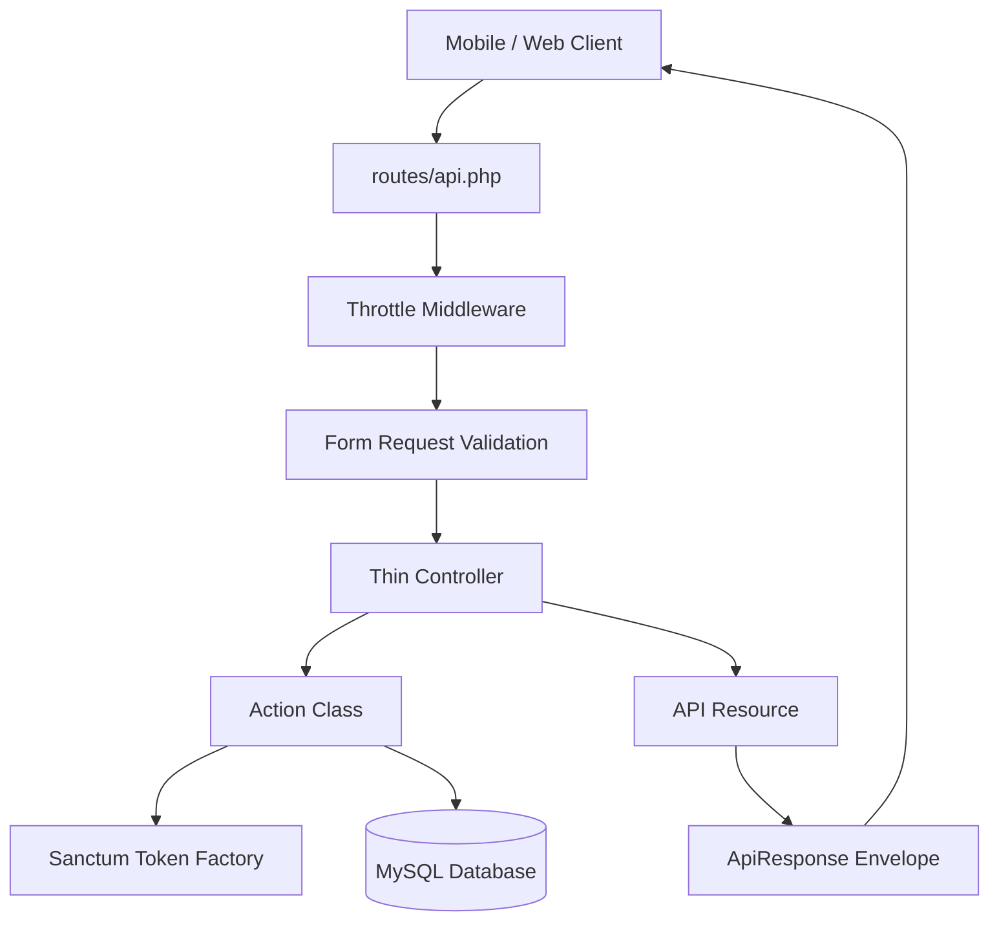

# 03 — Authentication & Security Module

> **Phase:** 5 · **Branch:** `feature/03-auth` · **Status:** Done
> **Figma screens:** Sign In, Sign Up, Forgot Password, Google OAuth, Profile header & user state

## 1. Overview

The Authentication & Security module provides enterprise-grade authentication for the Collabspace API-only backend. Built using Laravel Sanctum, it supports registration, email/password login, Google OAuth SSO (`id_token` verification via Google client / Socialite), password reset with timing-attack and user-enumeration defense, email verification links mapped to frontend SPA routes, and session token management with remember-me lifecycle options.

## 2. Business Rules 💼

| # | Rule | Enforced in |
|---|---|---|
| 1 | Strong passwords required (min 8 chars, mixed case, numbers, symbols, uncompromised check via HaveIBeenPwned) | `RegisterRequest`, `ResetPasswordRequest` |
| 2 | Remember-me token expiry: 30 days when `remember_me: true`, 24 hours when false | `RegisterUserAction`, `AuthenticateUserAction`, `HandleGoogleAuthAction` |
| 3 | User enumeration prevention on forgot password (always returns standard success message regardless of email existence) | `SendPasswordResetLinkAction`, `ForgotPasswordController` |
| 4 | Brute-force protection on authentication endpoints (5 attempts per minute per email + IP) | `RateLimiter` (`login` throttle), `routes/api.php` |
| 5 | Dual logout controls: revoke current token only (`POST /auth/logout`) or revoke all active sessions (`POST /auth/logout-all`) | `LogoutController` |
| 6 | Default role assignment: every newly registered user automatically receives the `member` role | `RegisterUserAction` |
| 7 | Multi-language support: localized messages in English (`en`) and Arabic (`ar`) via `Accept-Language` header | `lang/en/collabspace.php`, `lang/ar/collabspace.php` |

## 3. Endpoints

| Method | URI | Description | Auth | Throttle |
|---|---|---|---|---|
| POST | `/api/v1/auth/register` | Register new user account | Guest | `api` (60/min) |
| POST | `/api/v1/auth/login` | Authenticate with email & password | Guest | `login` (5/min per email+IP) |
| POST | `/api/v1/auth/google` | Authenticate with Google ID Token | Guest | `login` (5/min per email+IP) |
| POST | `/api/v1/auth/forgot-password` | Send password reset email | Guest | `6,1` (6/min) |
| POST | `/api/v1/auth/reset-password` | Complete password reset with token | Guest | `6,1` (6/min) |
| GET | `/api/v1/auth/email/verify/{id}/{hash}` | Verify email address | Guest | `api` (60/min) |
| GET | `/api/v1/auth/me` | Fetch authenticated user profile & roles | `auth:sanctum` | `api` (60/min) |
| POST | `/api/v1/auth/logout` | Revoke current access token | `auth:sanctum` | `api` (60/min) |
| POST | `/api/v1/auth/logout-all` | Revoke all tokens across all devices | `auth:sanctum` | `api` (60/min) |
| POST | `/api/v1/auth/email/verification-notification` | Resend verification notification | `auth:sanctum` | `6,1` (6/min) |

### Example Request / Response

#### Login Request
```http
POST /api/v1/auth/login
Content-Type: application/json
Accept: application/json

{
  "email": "mohamed.salah@collabspace.test",
  "password": "Password123!",
  "remember_me": true
}
```

#### Login Success Response
```json
{
  "success": true,
  "message": "Authenticated successfully.",
  "data": {
    "token": "1|qX1k...sanctum_plain_text_token",
    "token_type": "Bearer",
    "expires_at": "2026-12-23T21:46:00.000000Z",
    "user": {
      "id": "01JM7XYZ000000000000000001",
      "name": "Mohamed Salah",
      "email": "mohamed.salah@collabspace.test",
      "email_verified": true,
      "job_title": "Senior UI/UX Designer",
      "years_of_experience": 6,
      "avatar_url": null,
      "bio": "Experienced UI/UX Designer...",
      "phone_country": "EG",
      "phone_number": "+201234569878",
      "availability_status": "available",
      "timezone": "Africa/Cairo",
      "locale": "en",
      "roles": ["member"],
      "joined_at": "2022-04-01T00:00:00.000000Z"
    }
  }
}
```

## 4. Data Model

- **Users Table:** Identified publicly by ULID (`ulid`, char 26, unique index). Indexed on `email`, `google_id`, `availability_status`.
- **Personal Access Tokens Table (Sanctum):** Stores SHA-256 hashed tokens, scopes, and `expires_at` timestamps for automatic expiration.
- **Password Reset Tokens Table:** Stores bcrypt-hashed reset tokens keyed by email with 60-minute default expiration.

## 5. Architecture



- **Requests:** `RegisterRequest`, `LoginRequest`, `GoogleAuthRequest`, `ForgotPasswordRequest`, `ResetPasswordRequest`.
- **Actions:** Encapsulate business logic with atomic transactions (`DB::transaction` where needed):
  - `RegisterUserAction`
  - `AuthenticateUserAction`
  - `HandleGoogleAuthAction`
  - `SendPasswordResetLinkAction`
  - `ResetPasswordAction`
- **Resources:**
  - `UserResource`: Public user representation (exposing ULID, never numeric DB primary keys).
  - `AuthResponseResource`: Envelope combining bearer token, token type, expiry, and user profile.

## 6. Security 🔒

- **No Numeric ID Leaks:** API consumers interact strictly via ULIDs.
- **Brute Force Defense:** Dedicated rate limiter `login` restricts failed and successful login attempts to 5/minute based on compound key `email + IP`.
- **User Enumeration Prevention:** Forgot password endpoint returns a constant success response whether or not the account exists, preventing email harvesting.
- **Hashed Credentials:** Passwords hashed with Bcrypt (cost 12 in production, cost 4 in tests for speed). Tokens hashed with SHA-256 in DB.
- **Strict Hydration & Types:** `Model::shouldBeStrict()` enabled to prevent lazy-loading or unfillable property regressions.

## 7. Performance ⚡

- **Single Query User Hydration:** User roles are eagerly retrieved with token verification.
- **Lightweight Token Expiration:** Tokens carry explicit `expires_at` timestamps, enabling rapid cache and memory validations without database roundtrips.
- **Fast Test Executions:** Test suite runs with Bcrypt cost factor 4 and in-memory SQLite, completing all auth tests in under 5 seconds.

## 8. Tests

| Test File | Test Case | Status |
|---|---|---|
| `tests/Feature/Api/V1/Auth/RegisterTest.php` | Valid registration, weak password rejection, duplicate email rejection, remember-me 30d expiry | Passed |
| `tests/Feature/Api/V1/Auth/LoginTest.php` | Valid login, invalid credentials, brute-force rate limit trigger, remember-me expiry | Passed |
| `tests/Feature/Api/V1/Auth/PasswordResetTest.php` | Existing email forgot password, non-existing email forgot password, valid reset, invalid token rejection | Passed |
| `tests/Feature/Api/V1/Auth/AuthenticatedUserTest.php` | `/me` endpoint with bearer token, unauthenticated 401 response, single logout revocation, logout-all revocation | Passed |
