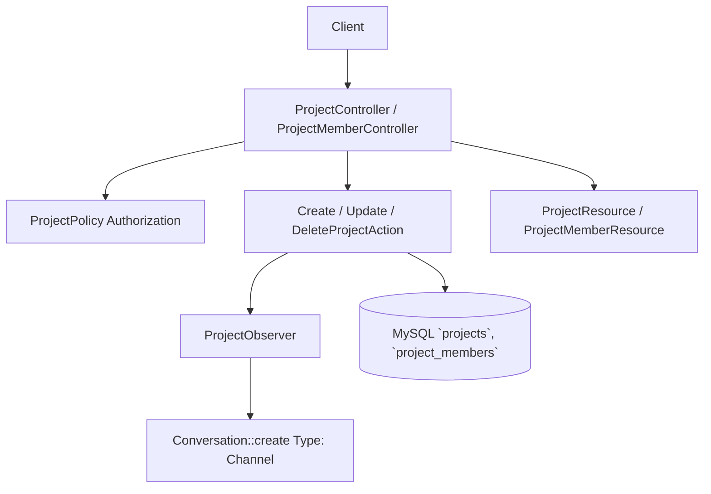

# 04 — Projects Module

> **Phase:** 6 · **Branch:** `feature/04-projects-and-tasks` · **Status:** Done
> **Figma screens:** Projects list ("Pet website Project", "Alpha Project"), Project details, Project cards & progress indicators, Members modal / avatars

## 1. Overview

The Projects module manages organizational workspaces and project lifecycles. It provides full CRUD operations, scoped visibility based on user membership and ownership, role-based member management with departmental assignments, automatic creation and synchronization of public chat channel conversations, and real-time project progress calculation derived from task status transitions.

## 2. Business Rules 💼

| # | Rule | Enforced in |
|---|---|---|
| 1 | Scoped visibility: non-admin users only view projects they own or are assigned to as members | `Project::scopeVisibleTo()`, `ProjectPolicy` |
| 2 | Automatic project lead: creating a project automatically assigns the creator as a project member with `is_leader = true` | `CreateProjectAction` |
| 3 | Automatic public chat channel: creating a project automatically initializes a public channel conversation (`ConversationType::Channel`) | `ProjectObserver` |
| 4 | Membership sync: adding or removing a project member automatically updates their access to all associated project channel conversations | `AddProjectMemberAction`, `RemoveProjectMemberAction` |
| 5 | Live progress tracking: project `progress` (0–100%) is automatically recalculated whenever constituent tasks change status | `TaskObserver` |
| 6 | Soft deletes: deleting a project preserves history and cascades safely without data destruction | `SoftDeletes` trait, `ProjectPolicy` |

## 3. Endpoints

| Method | URI | Description | Auth | Throttle |
|---|---|---|---|---|
| GET | `/api/v1/projects` | List visible projects with filtering & sorting | `auth:sanctum` | `api` (60/min) |
| POST | `/api/v1/projects` | Create a new project | `auth:sanctum` | `api` (60/min) |
| GET | `/api/v1/projects/{project}` | View project details, members, and task metrics | `auth:sanctum` | `api` (60/min) |
| PATCH | `/api/v1/projects/{project}` | Update project metadata or status | `auth:sanctum` | `api` (60/min) |
| DELETE | `/api/v1/projects/{project}` | Soft delete project | `auth:sanctum` | `api` (60/min) |
| GET | `/api/v1/projects/{project}/members` | List project members with roles and departments | `auth:sanctum` | `api` (60/min) |
| POST | `/api/v1/projects/{project}/members` | Add user as member to project | `auth:sanctum` | `api` (60/min) |
| DELETE | `/api/v1/projects/{project}/members/{user}` | Remove member from project | `auth:sanctum` | `api` (60/min) |

### Example Request / Response

#### Create Project Request
```http
POST /api/v1/projects
Content-Type: application/json
Authorization: Bearer <token>

{
  "name": "SepetGo E-Commerce",
  "description": "Pet website redesign and logistics tracking",
  "type": "web_app",
  "priority": "high",
  "start_date": "2026-01-01",
  "deadline": "2026-06-30"
}
```

#### Response (201 Created)
```json
{
  "success": true,
  "message": "Project created successfully.",
  "data": {
    "id": "01JM7Y00000000000000000001",
    "name": "SepetGo E-Commerce",
    "description": "Pet website redesign and logistics tracking",
    "type": "web_app",
    "priority": "high",
    "status": "active",
    "progress": 0,
    "start_date": "2026-01-01",
    "deadline": "2026-06-30",
    "completed_at": null,
    "members_count": 1,
    "tasks_count": 0,
    "created_at": "2026-01-01T12:00:00.000000Z"
  }
}
```

## 4. Architecture



## 5. Tests

| Test Class | Focus |
|---|---|
| `Tests\Feature\Api\V1\Projects\ProjectTest` | Scoped visibility, project creation, channel initialization, details, updates, soft delete |
| `Tests\Feature\Api\V1\Projects\ProjectMemberTest` | Adding members, auto-syncing to project conversations, removing members |
