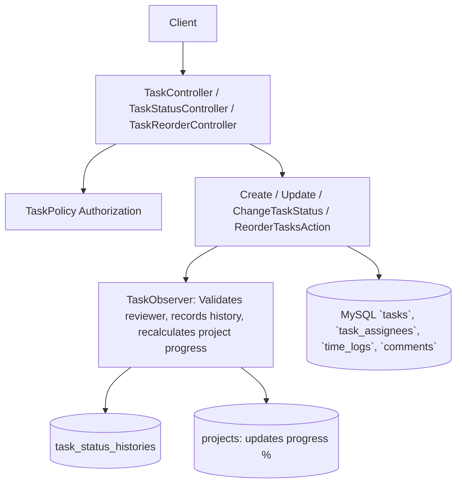

# 05 — Tasks & Kanban Board Module

> **Phase:** 6 · **Branch:** `feature/04-projects-and-tasks` · **Status:** Done
> **Figma screens:** Tasks Kanban Board (To-Do, In Progress, In Review, Completed columns), Task details modal, Task assignees & reviewers, Time tracking / hours worked, Task comments

## 1. Overview

The Tasks module implements an interactive Kanban task management system. Tasks are organized into sequential columns (`todo`, `in_progress`, `in_review`, `completed`), support drag-and-drop position sorting within and across columns, enforce reviewer requirements upon submission for review, maintain automatic audit history for every status change, and support time logging and threaded commentary.

## 2. Business Rules 💼

| # | Rule | Enforced in |
|---|---|---|
| 1 | **Reviewer requirement**: A task cannot transition to `in_review` without an assigned reviewer (`reviewer_id`). Violations throw `TaskReviewerRequiredException` (HTTP 422, `TASK_REVIEWER_REQUIRED`) | `TaskObserver`, `ChangeTaskStatusAction`, `ReorderTasksAction` |
| 2 | **Automatic status audit trail**: Every status transition automatically records a `TaskStatusHistory` entry with `from_status`, `to_status`, `user_id`, and `created_at` | `TaskObserver` |
| 3 | **Automatic project progress calculation**: Whenever a task status transitions to/from `completed`, the parent project's `progress` (0–100%) and `completed_at` timestamps are dynamically recalculated | `TaskObserver` |
| 4 | **Kanban drag-and-drop batch reordering**: Reordering tasks updates column statuses and relative `position` indices within a single database transaction | `ReorderTasksAction`, `TaskReorderController` |
| 5 | **Time tracking**: Team members log minutes with work dates and optional notes; total time is calculated on demand without N+1 queries | `TimeLogController`, `CreateTimeLogAction` |
| 6 | **Threaded task commentary**: Polymorphic `Comment` model supports discussions with soft deletion restricted to comment owners | `CommentPolicy`, `CommentController` |

## 3. Endpoints

| Method | URI | Description | Auth | Throttle |
|---|---|---|---|---|
| GET | `/api/v1/projects/{project}/tasks` | List tasks in Kanban column order (`position` asc) | `auth:sanctum` | `api` (60/min) |
| POST | `/api/v1/projects/{project}/tasks` | Create task with assignees and reviewer | `auth:sanctum` | `api` (60/min) |
| PUT | `/api/v1/projects/{project}/tasks/reorder` | Batch reorder tasks within / between Kanban columns | `auth:sanctum` | `api` (60/min) |
| GET | `/api/v1/tasks/{task}` | View task details, assignees, reviewer, and time summary | `auth:sanctum` | `api` (60/min) |
| PATCH | `/api/v1/tasks/{task}` | Update task title, description, priority, or assignees | `auth:sanctum` | `api` (60/min) |
| DELETE | `/api/v1/tasks/{task}` | Soft delete task | `auth:sanctum` | `api` (60/min) |
| PATCH | `/api/v1/tasks/{task}/status` | Transition task status (triggers reviewer validation) | `auth:sanctum` | `api` (60/min) |
| GET | `/api/v1/tasks/{task}/time-logs` | List time logs for task | `auth:sanctum` | `api` (60/min) |
| POST | `/api/v1/tasks/{task}/time-logs` | Log hours/minutes worked on task | `auth:sanctum` | `api` (60/min) |
| DELETE | `/api/v1/time-logs/{timeLog}` | Delete logged time entry | `auth:sanctum` | `api` (60/min) |
| GET | `/api/v1/tasks/{task}/comments` | List discussion comments on task | `auth:sanctum` | `api` (60/min) |
| POST | `/api/v1/tasks/{task}/comments` | Post comment on task | `auth:sanctum` | `api` (60/min) |
| DELETE | `/api/v1/comments/{comment}` | Delete comment | `auth:sanctum` | `api` (60/min) |

### Example Request / Response

#### Move Task to In Review without Reviewer (Business Rule Invariant)
```http
PATCH /api/v1/tasks/01JM7T00000000000000000001/status
Content-Type: application/json
Authorization: Bearer <token>

{
  "status": "in_review"
}
```

#### Rejection Response (422 Unprocessable Entity)
```json
{
  "message": "A reviewer must be assigned before moving a task to In Review.",
  "code": "TASK_REVIEWER_REQUIRED"
}
```

#### Batch Kanban Reorder Request
```http
PUT /api/v1/projects/01JM7P00000000000000000001/tasks/reorder
Content-Type: application/json
Authorization: Bearer <token>

{
  "tasks": [
    { "id": "01JM7T00000000000000000001", "status": "in_progress", "position": 0 },
    { "id": "01JM7T00000000000000000002", "status": "in_progress", "position": 1 }
  ]
}
```

## 4. Architecture



## 5. Tests

| Test Class | Focus |
|---|---|
| `Tests\Feature\Api\V1\Tasks\TaskTest` | Ordered listing, task creation with assignees/reviewer, details, soft deletion |
| `Tests\Feature\Api\V1\Tasks\TaskStatusAndReviewerTest` | Rejection of review transition without reviewer, success with reviewer, history recording, project progress recalculation |
| `Tests\Feature\Api\V1\Tasks\KanbanReorderTest` | Multi-task drag-and-drop batch repositioning across status columns |
| `Tests\Feature\Api\V1\Tasks\TimeLogAndCommentTest` | Time logging, summary calculations, threaded comments, ownership deletion policies |
