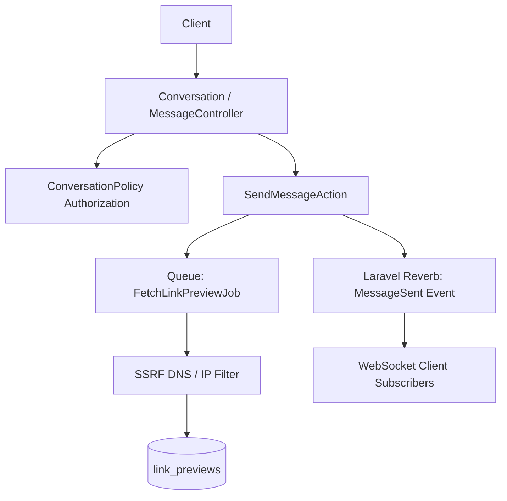

# 06 — Chats & Realtime Reverb Module

> **Phase:** 7 · **Branch:** `feature/05-chats` · **Status:** Done
> **Figma screens:** Chats sidebar ("Project Chats" / Public Channels & "Recent" / Direct Chats), Conversation pane with message bubbles, double checkmarks, threaded replies, rich external link previews, audio/voice actions, instant meeting call launcher

## 1. Overview

The Chats module provides full real-time communication capabilities for Collabspace. Powered by Laravel Reverb WebSockets, it supports 1-on-1 direct conversations, project-wide public channels, threaded message replies, automatic unread message counts, live read receipts (`message.read`), SSRF-safe OpenGraph link preview extraction, and instant meeting initiation from chat rooms.

## 2. Business Rules 💼

| # | Rule | Enforced in |
|---|---|---|
| 1 | Idempotent direct chats: only one direct conversation can exist between any pair of users, enforced by deterministic `direct_key` (`direct:min(id):max(id)`) | `StartDirectConversationAction` |
| 2 | Auto-project channel integration: project creation initializes a channel conversation; member additions/removals synchronize participants automatically | `ProjectObserver`, `AddProjectMemberAction`, `RemoveProjectMemberAction` |
| 3 | Read receipt tracking: sending a message automatically updates the sender's read marker; reading updates `last_read_message_id` and broadcasts `message.read` | `SendMessageAction`, `MarkConversationReadAction` |
| 4 | Enterprise SSRF protection: external link crawler verifies public IPs via DNS resolution, rejecting private ranges (`10.0.0.0/8`, `172.16.0.0/12`, `192.168.0.0/16`, `127.0.0.1`, `169.254.169.254`) | `FetchLinkPreviewJob` |
| 5 | Real-time WebSocket broadcasting: broadcasts `message.sent` and `message.read` events via Laravel Reverb to private channels (`conversations.{ulid}`) | `MessageSent`, `MessageRead`, `routes/channels.php` |
| 6 | Instant video meetings: starting an instant meeting from chat automatically creates a live `Meeting` and invites all conversation participants | `CreateInstantMeetingAction`, `ConversationController` |

## 3. Endpoints

| Method | URI | Description | Auth | Throttle |
|---|---|---|---|---|
| GET | `/api/v1/conversations` | List user's conversations with unread counts & previews | `auth:sanctum` | `api` (60/min) |
| POST | `/api/v1/conversations/direct` | Start or retrieve 1-on-1 direct chat with another user | `auth:sanctum` | `api` (60/min) |
| GET | `/api/v1/conversations/{conversation}` | View conversation details and active participants | `auth:sanctum` | `api` (60/min) |
| POST | `/api/v1/conversations/{conversation}/read` | Mark messages as read and broadcast read receipt | `auth:sanctum` | `api` (60/min) |
| POST | `/api/v1/conversations/{conversation}/instant-meeting` | Start instant live meeting from conversation | `auth:sanctum` | `api` (60/min) |
| GET | `/api/v1/conversations/{conversation}/messages` | List paginated message history | `auth:sanctum` | `api` (60/min) |
| POST | `/api/v1/conversations/{conversation}/messages` | Send message (broadcasts `message.sent`) | `auth:sanctum` | `messages` (30/min) |
| DELETE | `/api/v1/messages/{message}` | Soft delete message (sender only) | `auth:sanctum` | `api` (60/min) |

### Example Request / Response

#### Send Message Request
```http
POST /api/v1/conversations/01JM7C00000000000000000001/messages
Content-Type: application/json
Authorization: Bearer <token>

{
  "body": "Check out the design updates at https://github.com/MohamedAbdelshakor/collabspace-api"
}
```

#### Response (201 Created)
```json
{
  "success": true,
  "message": "Message sent successfully.",
  "data": {
    "id": "01JM7M00000000000000000001",
    "conversation_id": "01JM7C00000000000000000001",
    "body": "Check out the design updates at https://github.com/MohamedAbdelshakor/collabspace-api",
    "sender": {
      "id": "01JM7XYZ000000000000000001",
      "name": "Mohamed Salah",
      "avatar_url": null
    },
    "parent_id": null,
    "replies_count": 0,
    "link_previews": [
      {
        "url": "https://github.com/MohamedAbdelshakor/collabspace-api",
        "title": "MohamedAbdelshakor/collabspace-api",
        "description": "Collabspace backend API platform",
        "image_url": "https://opengraph.githubassets.com/..."
      }
    ],
    "created_at": "2026-11-24T09:30:00Z"
  }
}
```

## 4. Architecture



## 5. Tests

| Test Class | Focus |
|---|---|
| `Tests\Feature\Api\V1\Chats\ChatTest` | Direct chat initialization, listing with unread counts, sending messages, Reverb event broadcasting, thread replies, read receipts, sender deletion, instant meeting launch, unauthorized access prevention |
| `Tests\Unit\Jobs\FetchLinkPreviewJobTest` | Rejection of private IPs/localhost (SSRF protection), extraction and caching of valid OpenGraph metadata |
