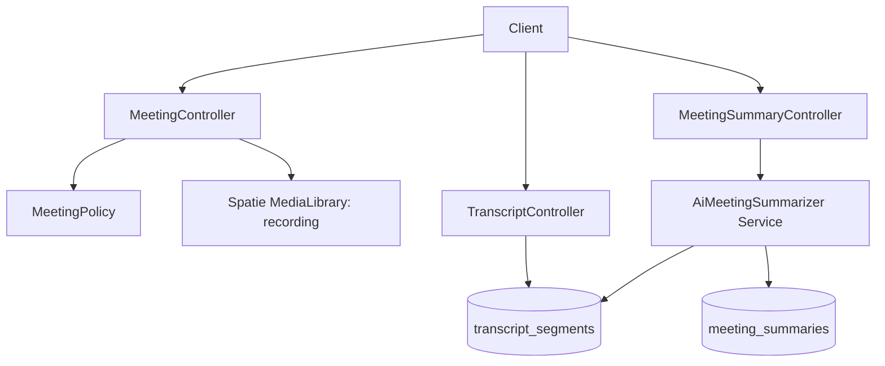

# 07 — Meetings & AI Summarization Pipeline

> **Phase:** 8 · **Branch:** `feature/06-meetings` · **Status:** Done
> **Figma screens:** Meetings Calendar & Schedule view (daily/weekly/monthly filter), Meeting detail modal/page with video player, live transcript segments with timestamps and speakers, collaborative meeting notes, and AI-generated Executive Summary (Key Points & Action Items).

## 1. Overview

The Meetings module manages scheduled and live meetings across projects and teams. It incorporates MediaLibrary file management for video recordings, searchable timestamped transcripts, collaborative meeting notes, and an AI summarization pipeline (`AiMeetingSummarizer`) that digests multi-speaker transcripts into structured Key Points and Action Items with assignees.

## 2. Business Rules 💼

| # | Rule | Enforced in |
|---|---|---|
| 1 | Meeting Scoping & Privacy: Users can only see meetings where they are the organizer, an invited attendee, or a member of the associated project. Admins can see all. | `MeetingController@index`, `MeetingPolicy@view` |
| 2 | Automatic Organizer RSVP: Scheduling a meeting automatically adds the organizer as an attendee with `accepted` status; invited members start as `pending`. | `CreateMeetingAction` |
| 3 | Granular RSVP: Invited attendees can update their status to `accepted`, `declined`, or `tentative`. | `RsvpMeetingAction`, `MeetingController@rsvp` |
| 4 | Recording Processing: Uploading an MP4/WEBM recording updates `recording_status` to `ready`, stores the file via Spatie MediaLibrary under the `recording` disk, and exposes an authenticated URL. | `UploadMeetingRecordingAction` |
| 5 | Searchable Multi-Speaker Transcripts: Segments are ordered by `start_second`, linked to speaker users, and support full-text/prefix search across transcript text and speaker names. | `TranscriptController`, `AddTranscriptSegmentsAction` |
| 6 | AI Summary Pipeline: `AiMeetingSummarizer` parses chronological transcript segments to generate structured key takeaways and action items with assignees matching the Figma UI specifications. | `AiMeetingSummarizer`, `GenerateMeetingSummaryAction` |
| 7 | Idempotent Collaborative Notes: Notes per user per meeting are unique (`['meeting_id', 'user_id']`), allowing collaborative note-taking without duplicate record conflicts. | `CreateMeetingNoteAction` |

## 3. Endpoints

| Method | URI | Description | Auth | Throttle |
|---|---|---|---|---|
| GET | `/api/v1/meetings` | List accessible meetings with calendar date range filters | `auth:sanctum` | `api` (60/min) |
| POST | `/api/v1/meetings` | Schedule a new meeting with attendee invitations | `auth:sanctum` | `api` (60/min) |
| GET | `/api/v1/meetings/{meeting}` | View meeting details, attendee counts, and status | `auth:sanctum` | `api` (60/min) |
| PATCH | `/api/v1/meetings/{meeting}` | Update meeting details/status (organizer/admin only) | `auth:sanctum` | `api` (60/min) |
| DELETE | `/api/v1/meetings/{meeting}` | Soft delete meeting (organizer/admin only) | `auth:sanctum` | `api` (60/min) |
| POST | `/api/v1/meetings/{meeting}/rsvp` | Update attendee RSVP status (`accepted`, `declined`, `tentative`) | `auth:sanctum` | `api` (60/min) |
| POST | `/api/v1/meetings/{meeting}/recording` | Upload meeting video recording (MP4/WEBM) | `auth:sanctum` | `api` (60/min) |
| GET | `/api/v1/meetings/{meeting}/transcripts` | Retrieve timestamped transcript segments (filterable by search/language) | `auth:sanctum` | `api` (60/min) |
| POST | `/api/v1/meetings/{meeting}/transcripts` | Append batch transcript segments | `auth:sanctum` | `api` (60/min) |
| GET | `/api/v1/meetings/{meeting}/summary` | Retrieve latest AI-generated summary | `auth:sanctum` | `api` (60/min) |
| POST | `/api/v1/meetings/{meeting}/summaries/generate` | Trigger AI summarization pipeline on transcripts | `auth:sanctum` | `api` (60/min) |
| GET | `/api/v1/meetings/{meeting}/notes` | List collaborative meeting notes | `auth:sanctum` | `api` (60/min) |
| POST | `/api/v1/meetings/{meeting}/notes` | Create or update meeting note (per-user idempotent) | `auth:sanctum` | `api` (60/min) |
| DELETE | `/api/v1/meetings/notes/{note}` | Delete meeting note (author/admin only) | `auth:sanctum` | `api` (60/min) |

### Example Request / Response

#### Generate AI Summary Request
```http
POST /api/v1/meetings/01JM7M00000000000000000001/summaries/generate
Content-Type: application/json
Authorization: Bearer <token>

{
  "language": "en"
}
```

#### Response (200 OK)
```json
{
  "success": true,
  "message": "Meeting summary generated successfully.",
  "data": {
    "id": 1,
    "language": "en",
    "key_points": [
      "The team reviewed the latest homepage design and agreed on the proposed layout.",
      "Several usability improvements were suggested for the sign-up flow.",
      "A follow-up review meeting was scheduled for next week."
    ],
    "action_items": [
      {
        "task": "Update wireframes with simplified input fields",
        "assignee": "Mohanad Wahib"
      },
      {
        "task": "Audit button contrast ratios for accessibility",
        "assignee": "Ahmed Hassan"
      }
    ],
    "generated_at": "2026-11-24T09:45:00Z"
  }
}
```

## 4. Architecture



## 5. Tests

| Test Class | Focus |
|---|---|
| `Tests\Feature\Api\V1\Meetings\MeetingTest` | Calendar listing with range filters and visibility scoping, scheduling with automatic organizer RSVP, attendee response updates, video recording upload, transcript pagination and fulltext search, AI summary generation, collaborative notes CRUD and authorization. |
