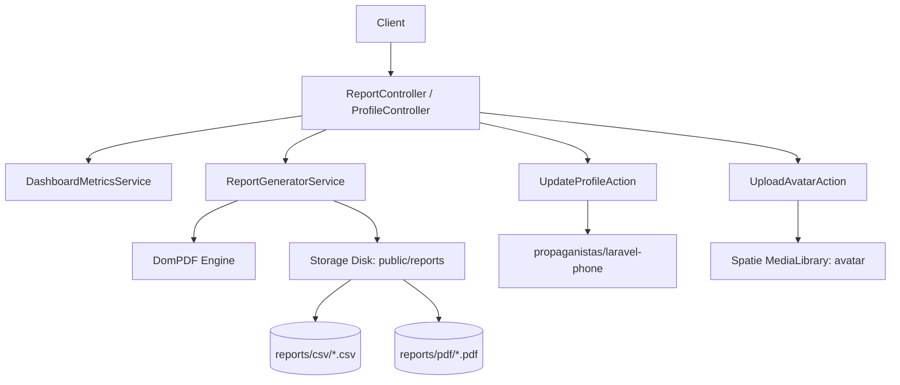

# 08 — Dashboard, Reports (CSV/PDF) & User Profile Module

> **Phase:** 9 · **Branch:** `feature/07-reports-and-profile` · **Status:** Done
> **Figma screens:**
> 1. Reports Dashboard: Top KPI rate cards (Task Completion Rate 70%, Projects Completion Rate 88%, Teams Activity Rate 67%), Task Completion Time vs Deadline bar chart, Projects Progress area chart, Worker Activity Rate line chart, Submit a detailed report form with AI badge and CSV/PDF export generation.
> 2. User Profile: Profile overview with avatar, Mohamed Salah UI/UX Designer, Joined Apr 2022, 140 completed tasks, 345 hours worked, bio ("About"), Recent Activities log.
> 3. Edit Profile: Personal info (name, email, phone with international prefix/validation, availability status), experience (job title, years of experience, current team/project).
> 4. Profile Tasks Tab: Divided into To Do (4 tasks) and Done (6 tasks).
> 5. Profile Files Tab: 9 file cards for Design Mockups with download links.

## 1. Overview

The Reports & Profile module provides comprehensive platform analytics, exportable executive reports, and an enterprise user profile management suite. Reports can be submitted with specific time bounds and automatically generate AI narrative summaries alongside downloadable CSV spreadsheets and printable PDF documents formatted through DomPDF. Profile management implements phone number validation powered by Google libphonenumber (`propaganistas/laravel-phone`), media library file handling for avatars, and user activity logging.

## 2. Business Rules 💼

| # | Rule | Enforced in |
|---|---|---|
| 1 | Realtime Platform Analytics: Dashboard & reports metrics provide dynamic rates (Task Completion Rate, Project Completion Rate, Team Activity Rate) with month-over-month trend indicators matching the Figma designs. | `DashboardMetricsService`, `ReportController@metrics` |
| 2 | Multi-Type Executive Reports: Reports support multiple operational scopes (`tasks_summary`, `project_status`, `team_performance`, `time_tracking`, `meetings_attendance`). | `CreateReportAction`, `ReportGeneratorService` |
| 3 | AI Narrative Insights: Generating a report produces an executive AI narrative synthesizing velocity, bottlenecks, and next steps. | `ReportGeneratorService` |
| 4 | Dual-Format Report Exports: Completed reports generate both UTF-8 CSV exports and print-ready PDF files via DomPDF stored under the public disk. | `ReportGeneratorService`, `resources/views/reports/pdf.blade.php` |
| 5 | International Phone Validation: Phone updates are validated against international E.164 formats using `propaganistas/laravel-phone` (`phone:AUTO,EG,US,INTERNATIONAL`), ensuring valid carrier and country numbering. | `UpdateProfileRequest` |
| 6 | Profile Scoping & Security: Non-admin users can only view and download their own generated reports (`403 Forbidden` on stranger reports). | `ReportController@show`, `ReportController@exportCsv`, `ReportController@exportPdf` |
| 7 | Profile Tasks & Files: Exposes segmented task states (`to_do` and `done`) and collaborative files matching the Figma profile tabs. | `ProfileController@tasks`, `ProfileController@files` |

## 3. Endpoints

| Method | URI | Description | Auth | Throttle |
|---|---|---|---|---|
| GET | `/api/v1/dashboard/stats` | Retrieve platform KPI summary cards | `auth:sanctum` | `api` (60/min) |
| GET | `/api/v1/reports/metrics` | Retrieve reports dashboard metrics & chart series | `auth:sanctum` | `api` (60/min) |
| GET | `/api/v1/reports` | List user's generated reports (paginated) | `auth:sanctum` | `api` (60/min) |
| POST | `/api/v1/reports` | Generate a new detailed report with CSV and PDF | `auth:sanctum` | `api` (60/min) |
| GET | `/api/v1/reports/{report}` | View report details and AI narrative | `auth:sanctum` | `api` (60/min) |
| GET | `/api/v1/reports/{report}/export/csv` | Download report as `.csv` file | `auth:sanctum` | `api` (60/min) |
| GET | `/api/v1/reports/{report}/export/pdf` | Download report as printable `.pdf` file | `auth:sanctum` | `api` (60/min) |
| GET | `/api/v1/profile` | View authenticated user profile with metrics and activities | `auth:sanctum` | `api` (60/min) |
| PATCH | `/api/v1/profile` | Update personal info & experience (with phone validation) | `auth:sanctum` | `api` (60/min) |
| POST | `/api/v1/profile/avatar` | Upload profile avatar image | `auth:sanctum` | `api` (60/min) |
| GET | `/api/v1/profile/tasks` | Retrieve user's assigned tasks (To Do vs Done) | `auth:sanctum` | `api` (60/min) |
| GET | `/api/v1/profile/files` | Retrieve user's uploaded and project design files | `auth:sanctum` | `api` (60/min) |

### Example Request / Response

#### Submit Detailed Report Request
```http
POST /api/v1/reports
Content-Type: application/json
Authorization: Bearer <token>

{
  "type": "tasks_summary",
  "note": "Q4 sprint deliverables and velocity audit",
  "start_date": "2026-10-01",
  "end_date": "2026-11-24"
}
```

#### Response (201 Created)
```json
{
  "success": true,
  "message": "Report generated successfully.",
  "data": {
    "id": "01JM7R00000000000000000001",
    "type": "tasks_summary",
    "type_label": "Tasks Summary Report",
    "note": "Q4 sprint deliverables and velocity audit",
    "start_date": "2026-10-01",
    "end_date": "2026-11-24",
    "status": "ready",
    "ai_summary": "Executive Analysis for Tasks Summary Report: Analyzed 24 records. Overall team velocity remains optimal...",
    "csv_url": "http://localhost:8000/storage/reports/csv/01JM7R00000000000000000001.csv",
    "pdf_url": "http://localhost:8000/storage/reports/pdf/01JM7R00000000000000000001.pdf",
    "created_at": "2026-11-24T10:15:00Z"
  }
}
```

## 4. Architecture



## 5. Tests

| Test Class | Focus |
|---|---|
| `Tests\Feature\Api\V1\Reports\ReportTest` | Dashboard KPI stats, reports metrics series (bar, area, line), report creation with AI summary generation, CSV download stream, PDF download stream, unauthorized cross-user report protection. |
| `Tests\Feature\Api\V1\Profile\ProfileTest` | Profile view with metrics (140 tasks, 345 hours) and recent activities, profile updates with E.164 phone validation, avatar image uploads via MediaLibrary, profile tasks segmentation (to-do vs done), profile files grid. |
