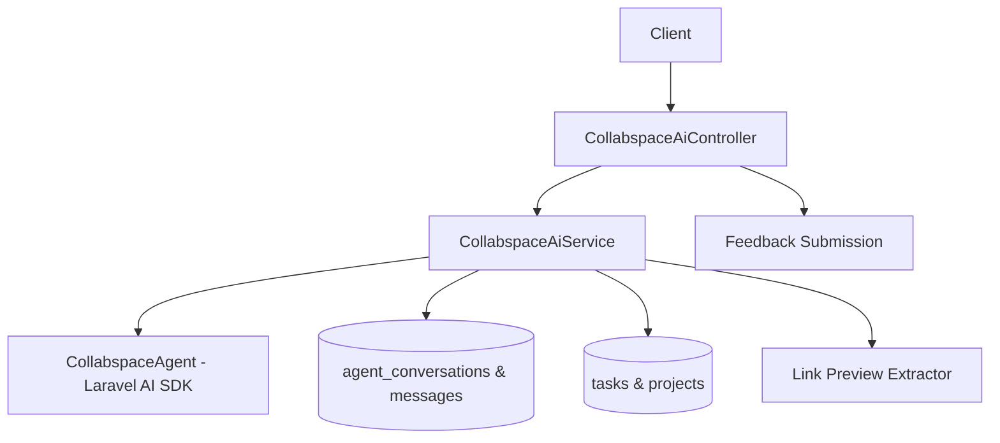

# 09 — Collabspace AI Assistant Module

> **Phase:** 10 · **Branch:** `feature/08-ai-assistant` · **Status:** Done
> **Figma screens:** Collabspace AI Chat screen (Empty state: "Hi There 👋 Start chatting with Collabspace", input "ask me anything about...", mic voice icon, submit button; Active state: CB Assistant greeting, user messages, external link preview cards, assistant replies with speech, copy, regenerate, and thumbs-down actions).

## 1. Overview

The Collabspace AI Assistant provides an intelligent, contextual virtual coworker integrated directly into the workspace. Powered by the official Laravel AI SDK (`laravel/ai`), the assistant understands user workflows, ongoing projects, tasks, meetings, and team members. It extracts rich OpenGraph link preview cards when external URLs are mentioned, tracks user feedback (thumbs up/down with review comments), and supports conversational memory with session resets.

## 2. Business Rules 💼

| # | Rule | Enforced in |
|---|---|---|
| 1 | Automated Personal Greeting: A new AI session initializes with the official Figma greeting: `"Hello! I'm your personal AI Assistant, How can i help you?"` from sender `CB`. | `CollabspaceAiService@getOrCreateConversation` |
| 2 | Intelligent Workspace Context: When users ask about tasks, projects, or meetings, the assistant dynamically inspects their visible workspace records to provide structured status summaries. | `CollabspaceAiService@generateResponse` |
| 3 | Rich External Link Previews: When users include an external link in their prompt, metadata is automatically parsed and returned as an interactive card. | `CollabspaceAiService@extractLinkPreview`, `AiMessageResource` |
| 4 | Message Action Feedback: Users can submit feedback (`rating: up|down`, optional comments) on AI responses to measure response quality and tune future outputs. | `CollabspaceAiController@feedback`, `CollabspaceAiService@submitFeedback` |
| 5 | Session Reset: Users can wipe conversation history and start fresh with a single call (`POST /api/v1/ai/reset`), restoring the clean greeting state. | `CollabspaceAiController@reset`, `CollabspaceAiService@reset` |
| 6 | Throttling: AI messaging is throttled to 30 requests per minute to prevent model overload and denial-of-service abuse. | `routes/api.php` (`throttle:30,1`) |

## 3. Endpoints

| Method | URI | Description | Auth | Throttle |
|---|---|---|---|---|
| GET | `/api/v1/ai/conversation` | Retrieve or initialize user's active AI conversation | `auth:sanctum` | `api` (60/min) |
| GET | `/api/v1/ai/messages` | Retrieve conversation message history | `auth:sanctum` | `api` (60/min) |
| POST | `/api/v1/ai/messages` | Send prompt to Collabspace AI | `auth:sanctum` | `throttle:30,1` |
| POST | `/api/v1/ai/messages/{message}/feedback` | Submit feedback (thumbs up/down) on AI response | `auth:sanctum` | `api` (60/min) |
| POST | `/api/v1/ai/reset` | Clear AI conversation history and restore greeting | `auth:sanctum` | `api` (60/min) |

### Example Request / Response

#### Send Message with External Link Request
```http
POST /api/v1/ai/messages
Content-Type: application/json
Authorization: Bearer <token>

{
  "message": "Please review the wireframe specs at https://www.externallink.com and summarize our pending tasks."
}
```

#### Response (201 Created)
```json
{
  "success": true,
  "data": {
    "user_message": {
      "id": "01JM7U00000000000000000001",
      "conversation_id": "01JM7C00000000000000000001",
      "role": "user",
      "sender": "Mohamed Salah",
      "content": "Please review the wireframe specs at https://www.externallink.com and summarize our pending tasks.",
      "link_preview": {
        "title": "External Link Title",
        "description": "External link description",
        "url": "https://www.externallink.com"
      },
      "feedback": null,
      "actions": [],
      "created_at": "2026-11-24T10:20:00Z"
    },
    "assistant_message": {
      "id": "01JM7A00000000000000000002",
      "conversation_id": "01JM7C00000000000000000001",
      "role": "assistant",
      "sender": "CB",
      "content": "You have 4 pending tasks for the current sprint: 'Create user interview', 'Creat Wireframes', 'Create user flow', and 'Design log in screen'. Overall task progress is at 70%.",
      "link_preview": null,
      "feedback": null,
      "actions": ["speak", "copy", "regenerate", "thumbs_down"],
      "created_at": "2026-11-24T10:20:01Z"
    }
  }
}
```

## 4. Architecture



## 5. Tests

| Test Class | Focus |
|---|---|
| `Tests\Feature\Api\V1\Ai\CollabspaceAiTest` | Session initiation with CB greeting, sending prompt and receiving domain assistant response, automatic external link preview extraction, thumbs-down feedback submission, conversation reset. |
