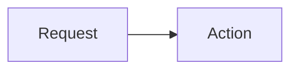

# NN — Feature Name

> **Phase:** N · **Branch:** `feature/NN-name` · **Status:** Draft | Done
> **Figma screens:** list of screens this feature serves

## 1. Overview

What the feature does and why it matters to the business.

## 2. Business Rules 💼

| # | Rule | Enforced in |
|---|---|---|
| 1 | Example: a task can move to In Review only with a reviewer | `MoveTaskAction` → `TaskTransitionNotAllowed` |

## 3. Endpoints

| Method | URI | Description | Auth | Throttle |
|---|---|---|---|---|
| GET | `/api/v1/...` | ... | `auth:sanctum` | `api` |

### Example request / response

```http
POST /api/v1/...
Authorization: Bearer <token>
Content-Type: application/json
```

```json
{ "data": {} }
```

## 4. Data Model

Tables/columns added or changed, indexes and why.

## 5. Architecture

Classes involved (Controllers, Requests, Actions, Queries, Events, Listeners, Jobs, Policies, Resources) and how they interact.



## 6. Security 🔒

Authorization, validation, rate limiting, data exposure decisions.

## 7. Performance ⚡

Queries, eager loading, indexes, caching, queues.

## 8. Tests

| Test | Covers |
|---|---|
| `tests/Feature/...Test.php` | ... |

## 9. Decisions & Trade-offs

Notable choices and the alternatives that were rejected.
